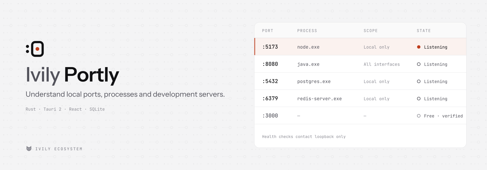
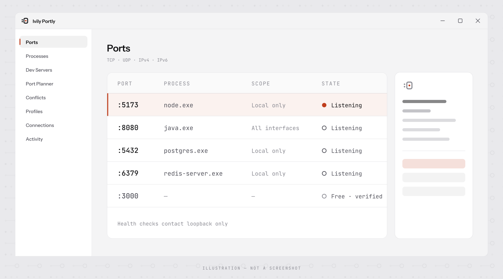
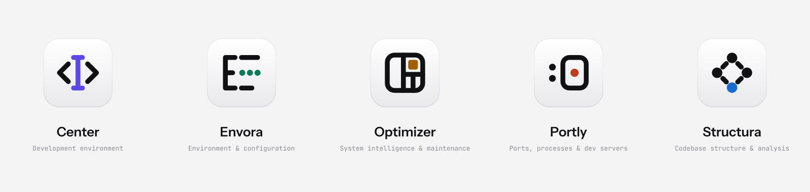

<p align="center">
  <picture>
    <source media="(prefers-color-scheme: dark)" srcset="assets/brand/banners/ivily-portly-readme-banner-dark.svg">
    
  </picture>
</p>

<p align="center">
  <a href="docs/USAGE.md">Usage</a> ·
  <a href="#build-from-source">Build</a> ·
  <a href="#principles">Principles</a> ·
  <a href="docs/ARCHITECTURE.md">Architecture</a> ·
  <a href="ROADMAP.md">Roadmap</a>
</p>

<p align="center">
  <a href="https://github.com/efecrtgl/ivily-portly/actions/workflows/ci.yml"></a>
  <a href="LICENSE"></a>
</p>

<h3 align="center"><code>Port 5173 is already in use.</code> — by what, since when, and is it safe to stop?</h3>

**Ivily Portly** is a lightweight, open-source desktop utility for developers. It shows which program holds which port, what your local dev servers are doing, and why a port is "already in use" — **without administrator rights and without ever running commands for you**. It works on its own and integrates, read-only, with the Ivily ecosystem.

> [!NOTE]
> **Status — 0.1.0, not yet released.** The backend, interface and repository infrastructure are complete ([roadmap](ROADMAP.md) phases 0–3). Phase 4 — the first published release with installer, signed updates and portable zip — is still open, so **build from source** for now.

<p align="center">
  <picture>
    <source media="(prefers-color-scheme: dark)" srcset="assets/brand/illustrations/ivily-portly-product-visual-dark.svg">
    
  </picture>
  <br><sub><i>Illustration, not a screenshot.</i></sub>
</p>

## Features

<table>
<tr>
<td width="50%" valign="top">

#### See

- **Real-time port monitoring** — TCP and UDP, IPv4 and IPv6, owning process, binding scope (localhost only / all interfaces), well-known port hints. Adaptive refresh that slows down while the window is hidden.
- **Process intelligence** — path, owner, parent, start time, CPU, memory, icon and dev-server recognition with transparent reasons.
- **Network connections** — established and listening sockets with categories and rule-based review hints (not malware detection; no traffic inspection).
- **Activity Center** — persistent, searchable history with retention and privacy controls.

</td>
<td width="50%" valign="top">

#### Organize

- **Development server manager** — register projects with multiple ports, groups, favorites and metadata; loopback-only TCP/HTTP health checks, server history, detection of unregistered dev servers and of unrelated processes on your ports.
- **Port Planner** — *verified* availability (socket table + test bind + Windows excluded ranges), suggestions, personal reservations (clearly Portly-only), custom ranges and exportable port allocation plans with collision validation.
- **Profiles** — web, backend, full-stack, game, testing and custom profiles that focus monitoring; they never run anything.

</td>
</tr>
<tr>
<td valign="top">

#### Explain

- **Conflict intelligence** — shared ports, unexpected occupants, Windows exclusions, ownership changes, unresponsive servers and address mismatches, each with an explanation and safe suggestions.

</td>
<td valign="top">

#### Act — carefully

- **Safe process actions** — open the file location, copy details, and a confirmed termination flow that refuses critical Windows processes and guards against PID reuse.
- **Data safety** — SQLite with migrations, a backup before every upgrade, integrity checks with recovery, backup/restore and JSON import/export.

</td>
</tr>
</table>

Premium monochrome interface with dark/light themes and a custom window frame. Interface language: English (Turkish is on the [roadmap](ROADMAP.md)).

## Principles

| | |
|---|---|
| **Least privilege** | Runs as a standard user; never asks for elevation. |
| **Nothing runs automatically** | Portly never executes project commands. Termination always needs your confirmation. |
| **Honest** | Only Windows-verified exclusions are called "reserved by Windows". Indicators are review hints, not detections. Availability is verified, not guessed. |
| **Local and private** | No telemetry. Health checks contact loopback only. Paths aren't stored in history unless you opt in. |
| **Light** | Two short-lived worker threads while the window is open; no service, no tray residency. |

## Architecture

```
WebView2 · React (plain JS)    pages: Dashboard · Ports · Connections · Processes · Projects
                               · Planner · Profiles · Activity · Settings
        ▲ events (snapshot, conflicts, health)        │ validated IPC commands
Rust core · Tauri 2            monitor/ scan thread → snapshot → diff → events
                                        health thread (loopback TCP/HTTP only)
                               net/ IP Helper tables · excluded ranges   process/ Toolhelp · protect
                               conflicts · planner · insight · exchange · iep · store/ → SQLite
```

Ports come from `GetExtendedTcpTable` / `GetExtendedUdpTable` with owning PIDs for IPv4 and IPv6; Windows excluded ranges are read through fixed `netsh` invocations with a locale-independent parser. Details: [docs/ARCHITECTURE.md](docs/ARCHITECTURE.md).

**Stack:** Rust · Tauri 2 · React 19 (plain JavaScript) · SQLite (rusqlite) · Windows IP Helper and process APIs

## Build from source

**Requirements:** Windows 10/11 x64 · [Rust](https://rustup.rs) stable · Node.js 22+ · WebView2 runtime (preinstalled on Windows 11).

```powershell
npm ci
npm run tauri dev     # development
npm run tauri build   # installer → src-tauri\target\release\bundle\nsis
```

Checks: `npm run check`, `npm test`, and in `src-tauri`: `cargo test`, `cargo clippy --all-targets -- -D warnings`.

**Install (after the first release):** the release workflow will publish a per-user NSIS installer (no administrator rights), a portable zip and `SHA256SUMS.txt` on [Releases](https://github.com/efecrtgl/ivily-portly/releases). See [docs/INSTALLATION.md](docs/INSTALLATION.md).

## Documentation

| | |
|---|---|
| [Usage guide](docs/USAGE.md) | Every view, step by step |
| [Installation](docs/INSTALLATION.md) | Installer, portable build, requirements |
| [Architecture](docs/ARCHITECTURE.md) | Threads, modules, data flow |
| [Data management](docs/DATA.md) | Database, backups, import/export |
| [Ivily Ecosystem Protocol](docs/IEP.md) | Read-only integration surface |
| [Versioning](docs/VERSIONING.md) · [Releasing](docs/RELEASING.md) | Release process |
| [Security policy](SECURITY.md) · [Contributing](CONTRIBUTING.md) · [Changelog](CHANGELOG.md) · [Roadmap](ROADMAP.md) | |

## Security

Portly runs without elevation, never starts project commands, refuses to terminate critical Windows processes and re-checks process identity (start time) before any termination to guard against PID reuse. Health checks only ever contact loopback addresses. Report vulnerabilities privately as described in [SECURITY.md](SECURITY.md).

## The Ivily ecosystem

<p align="center">
  <picture>
    <source media="(prefers-color-scheme: dark)" srcset="assets/brand/ecosystem/ivily-ecosystem-lineup-dark.svg">
    
  </picture>
</p>

Portly exposes an optional, read-only, local **Ivily Ecosystem Protocol** surface for [Ivily Center](https://github.com/efecrtgl/ivily-center-main) ([docs/IEP.md](docs/IEP.md)). Sibling products: [Envora](https://github.com/efecrtgl/ivily-envora) · [Optimizer](https://github.com/efecrtgl/ivily-optimizer) · [Structura](https://github.com/efecrtgl/ivily-structura).

Brand assets — logos, icons, banners and usage rules — are in [`assets/brand/`](assets/brand/README.md).

## License

[MIT](LICENSE) © 2026 efecrtgl
