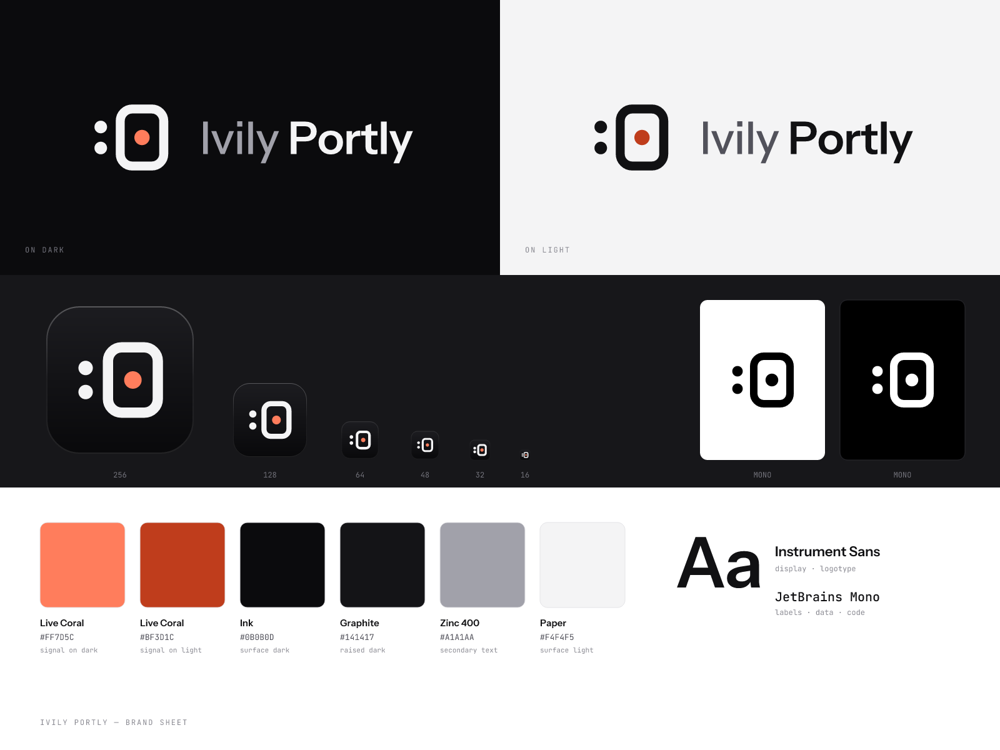

<p align="center">
  <picture>
    <source media="(prefers-color-scheme: dark)" srcset="logos/ivily-portly-horizontal-on-dark.svg">
    
  </picture>
</p>

# Ivily Portly — brand assets

Official logos, icons and visuals for Ivily Portly, part of the Ivily ecosystem.
The full brand guide (rationale, construction, colour, typography, usage rules) lives in the Ivily design workspace; this folder contains everything needed to use the brand from this repository.

<p align="center"></p>

## Identity in one paragraph

**Symbol — host:port — a live port.** Every developer reads ports as `host:port`. The symbol takes the **colon** of that notation and puts a **port** next to it — together they read like `:0`, a port number waiting to be filled in.

**Signal colour — Live Coral:** `#FF7D5C` on dark, `#BF3D1C` on light. Live Coral marks *live, occupied or attention-worthy ports*: listening state, conflicts, unexpected occupants. Free and verified ports use neutral styling.

## Contents

| Path | What | Use |
|---|---|---|
| `logos/ivily-portly-horizontal-*.svg` | **Primary logo** (symbol + "Ivily Portly") | READMEs, websites, documents |
| `logos/ivily-portly-vertical-*.svg` | Stacked logo | Splash screens, square placements |
| `logos/ivily-portly-logotype-*.svg` | Name only | Next to an existing symbol |
| `logos/ivily-portly-symbol-*.svg` | Symbol only | Title bars, favicons, tight spaces |
| `logos/png/` | Transparent PNG renders | Where SVG is not accepted |
| `icons/ivily-portly-app-icon.svg` | Application icon master (1024) | Source for every icon size |
| `icons/ivily-portly-app-icon-small.svg` | Optical variant for 16–32 px | Small icon sizes |
| `icons/ivily-portly-app-icon-light.svg` | Light container variant | Light marketing contexts |
| `icons/png/` | App icon PNG 16 → 1024 | Stores, websites, docs |
| `icons/ivily-portly.ico` | Windows icon (16, 24, 32, 48, 64, 128, 256) | Installer, shortcuts |
| `icons/tauri/` | Drop-in set with `src-tauri/icons/` file names | Adopting the icon in the app |
| `banners/ivily-portly-readme-banner-{dark,light}.svg` | README header, 1600 × 560 | This repository's README |
| `banners/ivily-portly-social-preview.png` | 1280 × 640 | GitHub → Settings → Social preview |
| `illustrations/ivily-portly-product-visual-*.{svg,png}` | Product visual — **illustration, not a screenshot** | Storytelling, docs |
| `patterns/ivily-portly-pattern-tile-*.svg` | Seamless tile | Backgrounds at 4–8 % opacity |
| `ecosystem/` | Ivily parent mark, ecosystem lineup and diagram | "Part of Ivily" sections |
| `palette.json`, `tokens.css` | Colour and type tokens | Web pages, future UI work |

Colourway suffixes: `-on-dark`, `-on-light`, `-mono-white`, `-mono-black`.

## Using the logo in Markdown

```html
<picture>
  <source media="(prefers-color-scheme: dark)" srcset="assets/brand/logos/ivily-portly-horizontal-on-dark.svg">
  
</picture>
```

## Adopting the new application icon

The application currently ships its existing icon (`src-tauri/icons/`) and its in-app logo is unchanged. Switching is a deliberate product decision. When ready:

```powershell
Copy-Item assets/brand/icons/tauri/* src-tauri/icons/ -Force
# or regenerate every platform size from the master:
npx tauri icon assets/brand/icons/ivily-portly-app-icon.svg -o src-tauri/icons
```

Then rebuild and check the taskbar, installer and Start-menu icons at 100 % and 150 % scaling.

## Rules

- Keep clear space of ¼ of the symbol height around every logo. Minimum symbol size 16 px.
- Use the colourway that matches the background; never recolour, outline, add effects, rotate or stretch.
- Only Live Coral may appear as a colour in Ivily Portly brand materials.
- Product visuals are illustrations and must be labelled as such.

---

<sub>Generated from the Ivily design workspace. Typefaces in logos: Instrument Sans and JetBrains Mono (SIL Open Font License 1.1), converted to outlines.</sub>
